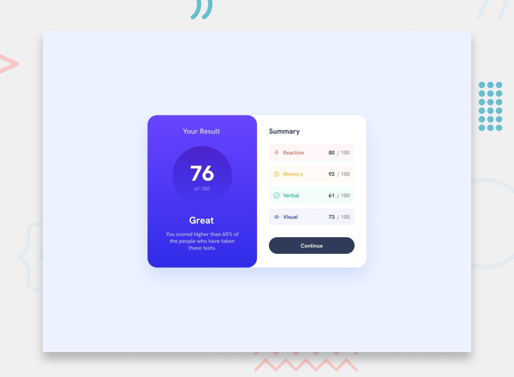

# 📌 Results Summary Component

This project is a solution to the "Results Summary Component" challenge on Frontend Mentor.

The challenge focuses on building a results summary component that displays a user's test scores across different categories. The goal was to reproduce the provided design as closely as possible, ensure the interface adapts to different screen sizes, and, as a bonus, populate the results and total score dynamically using the provided local JSON data.


## 🖼️ Preview



## 🎯 Overview

During the development of this project, the following aspects were implemented:

- Building the results summary component using semantic HTML elements
- Fetching the test results from a local `data.json` file
- Dynamically generating the category list items with JavaScript
- Calculating the total score from the individual category scores
- Validating the fetched data before rendering it to the page
- Handling loading errors gracefully without breaking the page
- Creating responsive layouts for mobile and desktop screen sizes
- Implementing hover and focus states for all interactive elements
- Applying the provided colors, typography, spacing, and visual hierarchy
- Reproducing the provided design as closely as possible


## 🧠 What I Learned

Through this project, I practiced:

- Understanding how a `Promise` represents a value that will be available in the future
- Requesting data from a local JSON file with `fetch`
- Writing asynchronous code in a more readable way with `async` / `await`
- Checking whether a request was actually successful with `response.ok`
- Handling errors with `try...catch` and throwing custom errors with `throw`
- Using guard clauses to exit a function early when the data is invalid
- Checking whether a value is an array with `Array.isArray`
- Verifying that every item meets a condition with `every`
- Transforming arrays with `map` and reducing them to a single value with `reduce`
- Writing shorter functions with arrow function syntax
- Extracting values from objects by name with destructuring
- Building strings that include variables with template literals
- Creating new elements with `createElement` and adding them to the page with `append`
- Writing text safely with `textContent` instead of `innerHTML`
- Adding `data-*` attributes to elements with `dataset`
- Using the `defer` attribute to run scripts after the HTML has been parsed


## 🛠️ Tech Stack & Concepts

- **Markup:** Semantic HTML
- **Styling:** CSS
- **Interactivity:** JavaScript
- **Data:** Local JSON file
- **Asynchronous JavaScript:** Fetch API, Promises & async / await
- **Error Handling:** try...catch & data validation
- **Responsive Design:** Mobile & desktop layouts
- **Layout:** CSS Box Model & Flexbox
- **Interactive States:** Hover & focus states
- **DOM Manipulation:** Dynamic element creation
- **Code Formatting:** Prettier
- **Version Control:** Git & GitHub


## 🔗 Links

- 💻 **Live Demo:** https://ncticn.github.io/011-results-summary-component
- 🧠 **Challenge:** [Add Frontend Mentor solution link here]


## ⚙️ Installation & Running the Project

To run this project locally, follow these steps:

```bash
# Clone the repository
git clone https://github.com/Ncticn/javascript-projects.git

# Navigate to the project directory
cd 011-results-summary-component
```

Then open the project with a local development server, such as the **Live Server** extension in VS Code.

> **Note:** Opening `index.html` directly in the browser will not work correctly, because browsers block `fetch` requests to local files. A local server is required to load `data.json`.


## 👤 Author

**Ncticn**  
Front-End Developer

- GitHub: https://github.com/Ncticn
- LinkedIn: https://www.linkedin.com/in/ncticn/
- Frontend Mentor: https://www.frontendmentor.io/profile/Ncticn


## 📝 License

This project is licensed under the MIT License.  
© 2026 Ncticn.