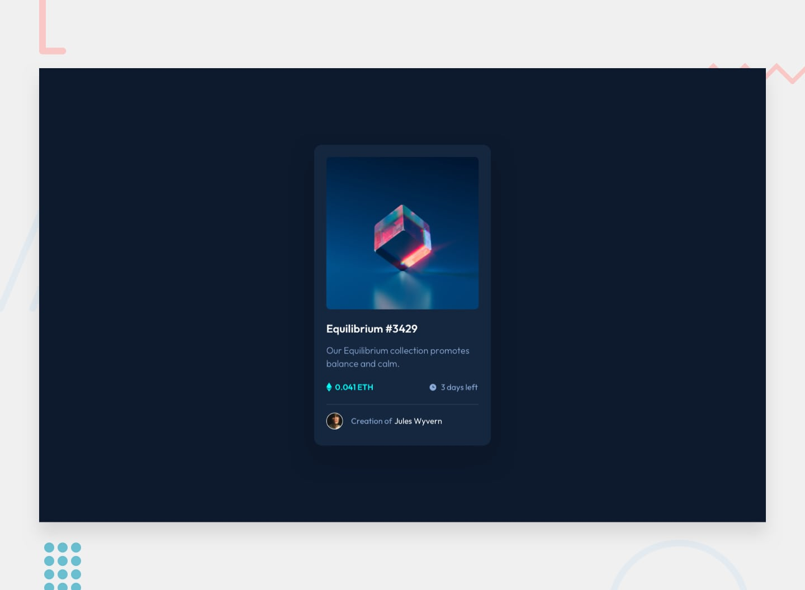

# 📌 NFT Preview Card Component
 
This project is a solution to the "NFT Preview Card Component" challenge on Frontend Mentor.
 
The challenge focuses on building an NFT preview card component using only HTML and CSS. The goal was to reproduce the provided design as closely as possible, ensure the layout adapts to different screen sizes, and add hover states for the interactive elements.


## 🖼️ Preview



## 🎯 Overview

During the development of this project, the following aspects were implemented:
 
- Building the preview card component using semantic HTML elements
- Creating responsive layouts for mobile and desktop screen sizes
- Adding an overlay with an icon that appears when hovering over the NFT image
- Implementing hover states for the title and creator name links
- Applying the provided colors, typography, spacing, and visual hierarchy
- Reproducing the provided design as closely as possible


## 🧠 What I Learned

Through this project, I practiced:

- Structuring a card component with semantic elements such as `<main>`, `<article>`, and `<footer>`
- Writing meaningful `alt` text for images
- Defining reusable colors and font sizes with CSS custom properties (`--variable`)
- Centering a component on the page with Flexbox and `min-height: 100vh`
- Spacing elements consistently with the `gap` property
- Using `position: relative` and `position: absolute` to place an overlay on top of an image
- Creating an image overlay with a pseudo-element (`::before` / `::after`)
- Showing the overlay on hover by combining `opacity` with `transition` for a smooth effect
- Styling a child element when its parent is hovered (e.g. `.image:hover .overlay`)
- Changing link colors on hover and using `cursor: pointer` for interactive elements
- Removing the small gap under images with `display: block`
- Using `border-radius` and `box-shadow` to style the card
- Adding a divider line with `border-top`
- Using `rem` units for scalable sizing
- Building a mobile-first layout and adjusting it for larger screens with media queries


# 🛠️ Tech Stack & Concepts
 
- **Markup:** Semantic HTML
- **Styling:** CSS
- **Responsive Design:** Mobile & desktop layouts
- **Layout:** CSS Box Model & Flexbox
- **Interactive States:** Hover states
- **Code Formatting:** Prettier
- **Version Control:** Git & GitHub


## 🔗 Links

- 💻 **Live Demo:** https://ncticn.github.io/013-nft-preview-card-component
- 🧠 **Challenge:** https://www.frontendmentor.io/solutions/nft-preview-card-component-html-css-4krmWUsJL0


## ⚙️ Installation & Running the Project

To run this project locally, follow these steps:

```bash
# Clone the repository
git clone https://github.com/Ncticn/javascript-projects.git

# Navigate to the project directory
cd 013-nft-preview-card-component
```

Then open the project with a local development server, such as the **Live Server** extension in VS Code.


## 👤 Author

**Ncticn**  
Front-End Developer

- GitHub: https://github.com/Ncticn
- LinkedIn: https://www.linkedin.com/in/ncticn/
- Frontend Mentor: https://www.frontendmentor.io/profile/Ncticn


## 📝 License

This project is licensed under the MIT License.  
© 2026 Ncticn.